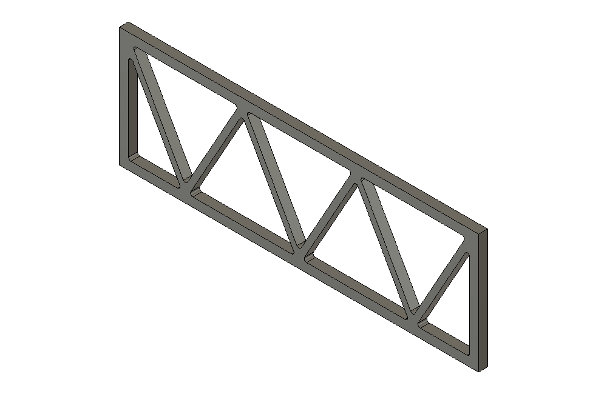

# Planar truss — 0.22.0

## Use

Choose **Patterns > Planar truss**. Select one rectangular face of a uniform solid
plate, then **Done**. Set the layout, Bays, Member width, Frame width and Span
direction and optional Junction fillet. Preview shows the actual cut body. **Create truss** confirms it;
**Edit existing** loads its saved settings and **Rebuild truss** updates that same
body. Cancel removes the temporary preview and restores source visibility.

| Setting | Behaviour |
| --- | --- |
| Layout | Warren, Pratt or Howe; initially Warren |
| Bays | Initially 6; Warren accepts 2–64, Pratt/Howe accept even counts 2–64 |
| Member width | Initially 2 mm, measured perpendicular to each diagonal/post; 0.4–100 mm |
| Frame width | Initially 3 mm of solid perimeter; 0.5–1000 mm |
| Junction fillet | Radius in mm at interior window corners; initially0 for sharp corners; the requested radius must fit every window |
| Span direction | Along long side initially, or along short side; measured in the selected plate |
| Thickness | Original plate thickness, preserved throughout |

The interface hides unrelated pattern/grille controls and empty advanced groups.
Controls have illustrated contextual help. The small drawing follows the
layout/count/direction; it is a schematic, separate from the real Fusion preview.

Warren has one alternating zigzag with no intermediate vertical posts and
`Bays + 1` windows, including its two end triangles. Pratt and Howe have opposite
diagonal orientations, vertical posts between bays and `2 × Bays` windows.
Pratt/Howe require even counts to retain central symmetry. Top/bottom refer to
the plate's local layout coordinates, not an applied world-space gravity load.
The geometry nomenclature follows the standard parallel-chord layouts; see
[SCI's truss overview](https://steelconstruction.info/topics/design/trusses/).
No load analysis or physical printed-strength rating is inferred from a name.

Actual Fusion results after changing the initial six bays to eight in Edit:

## Geometry and efficiency

`tools/truss/planner.py` is a new host-independent millimetre planner. It divides
the inner rectangle into triangles and proves that their areas cover the region.
Each interior triangle edge is inset by half the requested member width. Edges
on the frame keep the requested perimeter. This yields true perpendicular member
widths, connected junctions and disjoint convex windows, rather than overlapping
independent bars. Windows with inscribed radius below 0.1 mm are refused before
native solid creation, without silently reducing the member width or bay count.

The existing rectangular-plate inspection proves uniform material through the
entire thickness, including the back. One closed multi-loop BRep is then created
using the existing perforated-prism helper. Opposed shared edges, strict window
separation, exact volume and a single solid lump are checked. Work is bounded by
64 bays and at most 128 windows. There is no Boolean or feature per member and
no repeated wall query per triangular window. No StructForge code was copied.

The tool reuses the accepted pattern face picker, cached mesh preview, visibility
lease and in-place Cut persistence. It adds one owned cutter BaseFeature and one
native Cut. Rebuild replaces only the owned cutter geometry, retaining the target
identity, name, visibility, feature ID and history count. The shared store allows
one owned Pattern/Grille/Truss layout per body; these cannot be independently
stacked on the same body. Edit uses the original plate before the owned cut.

The0.26.2 shared settings recipe **16** contains28 fields. The grille-only
`grille_chamfer_mm` defaults to0 for exact versions1–13 and is inactive here.
The separate common
`pattern_fillet_mm` defaults to0 for exact versions1–11 and is inactive for
Planar truss. Versions1–10 gain the
previously absent `truss_fillet_mm=0` default; versions1–9 also gain the absent
`truss_bays=6` and `truss_axis=long` defaults. Exact old schemas
remain strict; reading an old recipe does not write attributes or alter geometry.
New truss styles are refused in old recipe versions. Grilles and other pattern
settings retain their existing dimensions and behaviour.

## Junction fillets (0.22.0)

**Junction fillet (mm)** rounds the three inside corners of every triangular
opening. It adds material where diagonals/posts meet the frame and each other;
the nominal member widths away from junctions, outer rectangular silhouette,
plate thickness and flat back are preserved. It is a through-thickness planar
fillet, without rounding the top/bottom cap edges or outside perimeter. Zero
uses the original sharp construction exactly. Saved recipes10 and earlier load
zero without modifying the existing model; explicit Rebuild saves recipe11.

The pure planner computes tangent endpoints/centres and exact circular-segment
areas. Equal radius must leave distinct positive straight portions on every
window edge; too large or numerically collapsed radii are refused before native
body allocation, with a fit limit and no automatic clamp. The previous valid
preview remains until suitable inputs are supplied.

The native adapter creates exact Arc3D edges and cylindrical side faces with
shared cap topology in a **single** healed BRepBodyDefinition. This reuses the
sharp-window frame/separation proofs because rounded holes are strict subsets.
There are no polygonal approximations, per-corner fillet features or per-window
booleans. Exact volume, single solid lump and one outward shell are checked.
Create/Rebuild still use the same owned cutter BaseFeature + Cut on the original
body; no extra final bodies or timeline entries are added for fillets.

Actual Fusion result, Warren with0.8mm junction radius:

1052 Python tests and four Node suites pass. Browser checks at320/380/440px
verify the truss-only radius control, sharp default, illustrated help and no
overflow; DOM regressions cover26-field snapshots, Edit restoration and an
oversized radius retained after refusal. Native Fusion2705.1.30 passes all three
styles in both directions, a60° inclined plate,384 exact cylindrical fillet faces
at64bays/128windows, preview cleanup, four style/radius Rebuilds (including zero),
read-only recipe10 loading followed by upgrade, and oversize refusal. Original
body/name/visibility/history and caller restoration remain unchanged. Native
checks inspect arc/cylinder radii, exact volume and1631 material/void witnesses.

The128-window case completed preparation plus independent geometry checks in
about1.08s on this fixture; this is not a universal preview timing. Native
selection is programmatic; manual CEF picking/orbit, save/reopen and physical
printing/load acceptance are not established by these tests. Evidence:
[truss-fillet-0.22.0.json](validation/truss-fillet-0.22.0.json).

## Supported geometry and limits

Use one native root-component rectangular planar face on a complete uniform
solid plate in a parametric Design, with the timeline at the end. The plate may
be inclined in 3D; the layout follows its face. It must have straight boundaries,
no holes/steps and a flat opposite back. The current rectangular chart alignment
requirements of the shared plate inspector apply. Multi-face, Whole body, curved,
arbitrary sketch-profile, hollow enclosure and variable-thickness inputs are not
supported. Unsupported selections are refused without model edits.

Every member is constant through the plate's original thickness. The intended
print orientation places the plate back on the bed; the add-in does not rotate
the document or export orientation. The release does not add raised/engraved
trusses, mounting holes, member chamfers, curved boundaries, FEA or load ratings.
Fit, adhesion, material strength and printing remain physical validation tasks.

## Validation

**1001 Python tests**, three Node UI suites, compilation and whitespace checks
pass. Independent tests sample both sides of every diagonal/post at half-width
±0.03 mm, confirm the frame, exact closed volumes, axis changes, bounded windows,
legacy schema defaults and early refusals. A command-session test checks the
truss preview message and that Create uses the reviewed result.

Headless Edge at 300/380/520 px passes three layouts, both span directions, odd
bay guards, all five help illustrations, hidden unrelated controls, family
switching and no horizontal overflow. This is separate from actual Fusion CEF
pointer/navigation acceptance.

Fusion 2705.1.30 passes **15 isolated MCP cases**: the three styles, odd Warren,
short-side layout, a plate inclined 60°, maximum 64 bays/128 windows, a style/
direction/dimension Edit cycle, six early refusals and a mounted-grille legacy
regression. Material witnesses measure real windows and both sides of every
member through the plate midpoint. Preview mesh draw/cleanup, Create/Edit/Rebuild,
unchanged body/name/visibility/history and restoration of the original caller
pass. All disposable documents are discarded without saving.

The 128-window fixture measured about 159 ms preparation, 608 ms Create and
2.2 s full read/prepare/Rebuild/read plus independent material checks. These are
fixture observations, not a universal performance promise. Actual pointer/orbit,
save/reopen, Undo/Redo and physical printing/load tests remain unproved.

Evidence: [planar-truss-0.17.0.json](validation/planar-truss-0.17.0.json).
