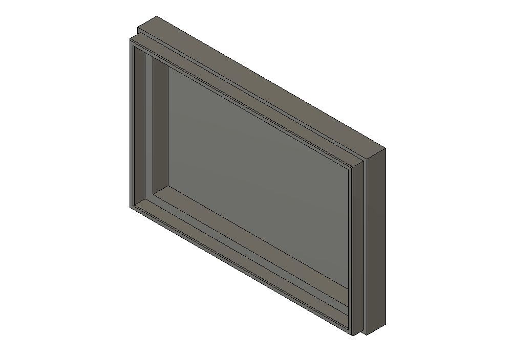
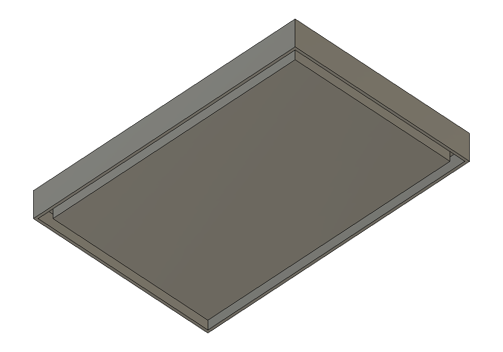
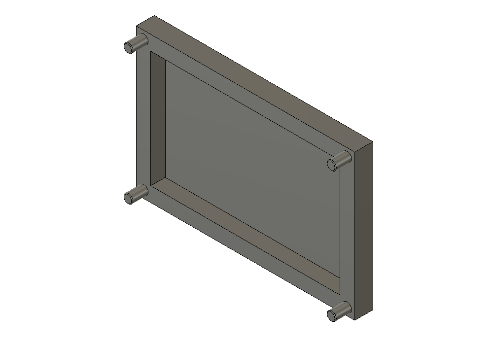
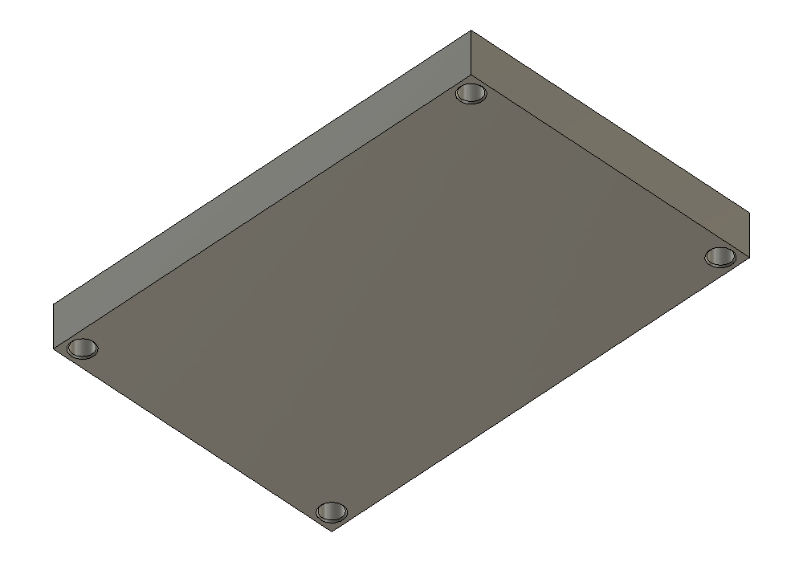
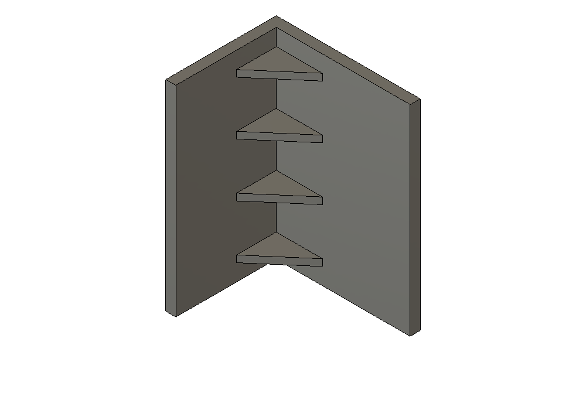

# Small details — 0.21.0

The Small details menu now implements **Lid lip & groove**, **Alignment pins** and
**Ribs & gussets**. Hardware pockets remains planned and unchanged. Each helper
uses its own selected geometry through the same independent HTML detail session,
live cached-mesh Preview, Create and Edit/Rebuild. Basic dimensions stay visible;
lead-ins, floor protection, insets and end margins live in Advanced settings.
Every parameter has contextual text and a local section/dimension illustration.

## Selecting the supports

For **Lid lip & groove** and **Alignment pins**, select **Base face A** and **Lid
inside face B** on two separate native root bodies. They must be parallel and
face each other across a nonnegative gap. Both need straight rectangular outer
boundaries. A rectangular enclosure rim is supported; inner voids or other
features are checked against the complete generated support/receiver volumes.
The lid can have a different outer size if the whole receiver fits in its material.
No shared seam edge needs to be selected.

For **Ribs & gussets**, select a wall and floor/support face on the **same body**.
The two planar faces must meet at 90° along one complete straight shared edge.
Full-volume checks require material behind both complete rib legs, so an outside
convex corner cannot masquerade as a supported inside corner. Heights, reaches
and count must fit the actual source faces and shared edge.

Preselecting both faces is supported. Otherwise select A and the picker advances
automatically to B. Continuous lips, pins and ribs preview after both supports.
Selected-side lips additionally require edge selection and Done. Re-picking
restores source visibility. Esc resets supports, or clears pending sides during
side selection; Cancel removes the temporary session. Stale previews block Create.

## Lid lip & groove

| Setting | Default and interpretation |
| --- | --- |
| Lip layout | Continuous perimeter; optionally Selected sides |
| Lip height | 2.5 mm outward from A toward B |
| Lip width | 1.2 mm across the continuous rectangular ring |
| Edge inset | 0.8 mm from A's outer boundary to the lip's outside |
| Side clearance | 0.25 mm on **each side** of the lip in the receiving groove |
| 45° lead-in | 0.2 mm at the tip; 0 disables it |
| End clearance | 0.3 mm past the lip tip |
| Keep floor | At least 0.5 mm original material behind the groove |

The lip is joined to A and the matching groove is cut into B together. The
receiver is positioned in A's frame, so its actual mating alignment is preserved
when B has different local surface axes. The face gap is deducted before computing
engagement and receiving depth. Height must exceed that gap by at least 0.2 mm.
Groove width is `lip width + 2 × side clearance`; receiving depth is
`height − face gap + end clearance`. The lead-in shrinks both sides of the lip
tip with 45° faces. It must be less than half the lip width and its height.

The complete ring root must be original A material. The complete receiving ring
and protected floor must be original B material. These are volume checks, not
samples that could miss a cavity or an opening through the opposite side.

**Selected sides:** choose the straight outer boundary edges on face A, or matching
edges on B. Normal clicks accumulate blue edges without Ctrl. Up to four sides
are supported. Clear sides or Esc starts that selection over; **Done · update
preview** confirms it. No geometry computation starts while choosing sides.
The matching groove follows only those sides. Adjacent sides form one continuous
L/U contour before the tip chamfer; opposite sides remain separate runs. Side
clearance applies around the ends as well. All four sides use the original ring
geometry. Saved masks load on Edit, and Lip sides lets you pick them again.

Actual Fusion base and matching lid after changing height to 3 mm in Edit:

## Alignment pins

The initial two pins occupy diagonally opposite corners; four pins use all four
corners. They are joined into A, with matching blind receiving holes in B. No
independent final pin bodies are created.

| Setting | Default and interpretation |
| --- | --- |
| Pins | 2; choose 2 or 4 |
| Pin diameter | 2.5 mm |
| Pin height | 4 mm from A toward B |
| Hole allowance | **0.3 mm added to diameter**: Ø2.5 pin → Ø2.8 hole |
| Edge to centre | 0 = Auto; room for the receiving radius, entry bevel and 0.5 mm outer margin |
| 45° lead-in | 0.2 mm pin-tip bevel and hole-entry bevel; 0 disables them |
| End clearance / Keep floor | 0.3 / 0.5 mm |

An explicit inset changes all corner centres symmetrically. Complete material
must support every pin root and receiving envelope/floor. This deliberately
refuses thin/narrow rims or a socket intersecting an existing groove. It does not
silently shrink pins or add unrequested bosses. Increase available material or
adjust inset/diameter. The entire head-entry envelope is conservatively checked
through the receiver and protected floor.

After editing from two 4 mm pins to four 4.4 mm pins:

## Ribs & gussets

Choose **Triangular gusset** or **Full rectangular rib**. Defaults are 2 mm rib
thickness, 12 mm width/reach on B, 12 mm height on A, three ribs and 5 mm end margins.
Height and Width are adjacent in the UI; Thickness occupies the next row.
Rib thickness is measured along the shared edge. Every rib is joined to the
existing body, with finite material overlap into both supports.

Counts 1–32 are supported. One rib is centred and honours the requested minimum
end margins. For multiple ribs, those margins are exact at the outer sides of
the first/last rib and all centre spacings are equal. A 60 mm edge, three 2 mm
ribs and 5 mm margins gives centres at 6, 30 and 54 mm. At least 0.2 mm separates
neighbouring rib envelopes. Overlapping or unsupported rows are refused.

Actual triangular row after editing to four ribs and 14 mm reach:

## Persistence, efficiency and limits

`tools/details/` contains immutable settings, bounded planners, detached Fusion
geometry, owned delta-tool storage and an HTML command adapter. It reuses the
proven rollback/zero-input native commit lifecycle and cached STL mesh display,
with independent command/event IDs. Native command registration and cleanup were
also checked in Fusion. The same normal body appearance is used in the opaque
preview; orbiting does not intentionally dispose its mesh.

Only the added lip/pins/ribs and receiving cutters are saved as BaseFeature
tools. The native history uses **BaseFeature + Join + Cut** for a mating pair,
or **BaseFeature + Join** for a rib row. Repeated disconnected tools are grouped
into a single consumed tool per target. There is no complete copied result body,
hidden backup, component creation, or native feature per pin/rib.

Different details can be added sequentially to the same bodies. A native fixture
combines a lip and pins on a 6 mm rim, with pin inset 4 mm, then edits the pins.
This does not make arbitrary intersections between an existing groove and a new
socket valid; the material checks still apply.

**Edit is restricted to a detail at the end of the timeline.** Preserve/remove or
move later features before editing an earlier detail. This prevents a preview
from concealing or overwriting later changes. When several details of the same
type exist on one body, select the specific named timeline feature. Ownership,
feature ordering, Combine definitions, tool hashes, result hashes and historical
face references are checked. Rebuild updates the same source tools and retains
target body tokens, names, visibility, feature IDs and history counts. Failed
native writes rely on the enclosing Fusion command transaction for rollback.

The recipe is a separate strict version-2 Small details schema with 21 settings.
Version-1 records require their exact original 19 fields; they load as closed
perimeter/15 in memory without being rewritten. Explicit Rebuild saves version2.
Existing hinge/snap/pattern/truss records are unchanged. Starting another tool
while one owns selection/preview is blocked in both HTML and the host. Late
responses and retired session pushes cannot reactivate a cancelled session.

The tools currently cover rectangular mating faces and perpendicular straight
inside corners on root-component solids in a parametric Design. Circular lips,
arbitrary boundaries, point-placed pins, tapered/rounded pin families, non-90°
ribs, member edge fillets and hardware pockets are not introduced. The selected
support faces define orientation; the document/export is not automatically
rotated for printing. Geometry and 45° leads do not certify printed fit, support
requirements, fatigue, strength or load capacity.

## Validation

**1016 Python tests**, three existing Node UI suites, compilation and whitespace
checks pass. Headless Edge at 300/380/520 px exercises all three helpers through
selection, typed full snapshots, Preview, parameter edits, help diagrams, Create,
Edit, Cancel, retired/late push rejection, input limits, tool locks and unchanged
Hardware pockets availability. These browser checks use a simulated host and are
separate from actual Fusion CEF pointer acceptance.

Fusion 2705.1.30 passes **18 functional fixtures and two additional visual
fixtures**. They cover the three tools, optional leads, tighter lip clearance,
2/4 pins, triangle/full/1/32-rib rows, protected-floor/support/overlap/count refusals,
stacked lip/pins and the earlier-feature Edit guard. Independent material/void
witnesses check lip engagement/clearance/floors, pin and socket diameters, rib
width/reach/style and the rebuilt persistent bodies. Cached preview draw/cleanup,
Create/Edit/Rebuild and original caller restoration pass. All fixture documents
are discarded without saving; native images show their actual generated geometry.

The 32-rib fixture prepared in roughly 0.4 seconds in this session. Timings vary
with source geometry and hardware. Physical printing, full CEF picking/orbit,
save/reopen and Undo/Redo acceptance remain unproved.

Evidence: [small-details-0.18.0.json](validation/small-details-0.18.0.json).

## In-app examples (0.18.1)

Each implemented Small details tool now has an expandable **Examples · προετοιμασία & βήματα** section. It explains the required existing geometry, face A/B selection with a labelled diagram, the exact UI steps, starting dimensions, clearance/depth calculations, actual Fusion result images and common selection/material errors. The lid/pin diagram is exploded only for readability: the actual lid must remain at its closing position. Rib examples require one joined inside corner.

The detailed guide is local and rendered only when the tool changes, preserving its expanded questions while parameters update. Native result images reuse the 0.18.0 evidence above; this release changes documentation/UI only and does not rerun or extend native geometry claims.

Browser checks at 300/380/520 px pass for all three guides: six sections, labelled support diagrams, five local images decoded, no horizontal overflow and stable guide/FAQ state through parameter edits. Existing three Node UI suites pass. Evidence: [detail-examples-0.18.1.json](validation/detail-examples-0.18.1.json).

## Selection and saved operations (0.19.0)

Support selection now advances A → B automatically and Esc clears references/preview while keeping dimensions. The **In this design** list opens a specific saved operation; **Pick from model** is the alternate selection path. New operations have named native timeline groups and distinct Lip/Groove or Pins/Pin holes children. See [selection-history.md](selection-history.md) for Edit, deletion, legacy adoption, dependency limits, scrolling and scoped validation.

## Selected-side validation (0.21.0)

1041 Python tests and four Node UI suites pass. A simulated-host browser check at
320/380/440 px verifies Height/Width ordering, separate Thickness,21-field
snapshots, locked parameters during side picking, no preview before Done and no
horizontal overflow.

Fusion2705.1.30 passes all15 side masks with0/.2mm lead-ins (30 detached geometry
cases,240 independent material/void witnesses), cached preview cleanup,
Create3 → Rebuild5/7/15/1, unchanged target identity/body counts/history, Edit
selection seeding, native edge highlight accumulation and B-edge alias
deduplication. Clear, empty Done refusal, invalid-face refusal and Cancel handler
cleanup also pass. Tests use programmatic native events/selections in a discarded
fixture document; they do not establish manual CEF pointer, save/reopen or physical
printing acceptance. The caller model remains unchanged. Native preparation was
approximately25–59ms on this fixture; timing depends on source geometry/hardware.

Evidence: [selected-lip-0.21.0.json](validation/selected-lip-0.21.0.json).
