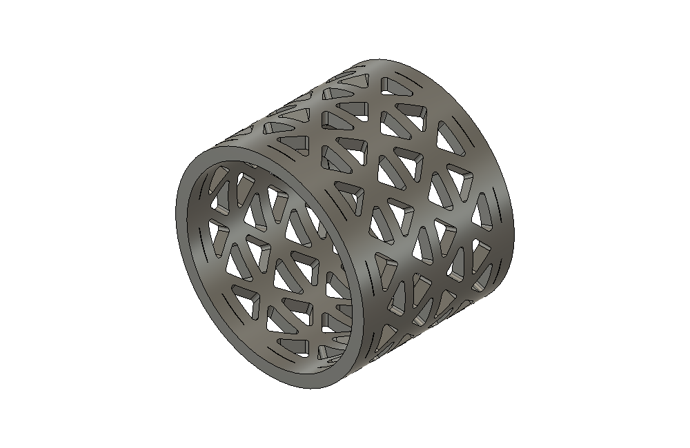
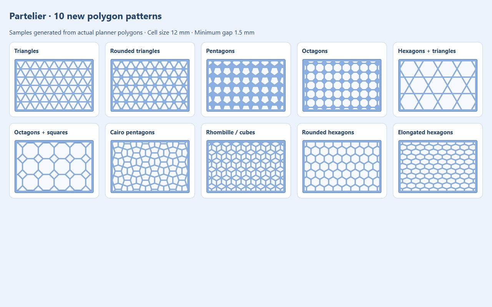

# Surface patterns

Grilles0.26.0 adds exact45° raised bevels, **Chamfer size** (0=Auto) and
more accessible **Screw inset** controls. Auto screws sit0.8mm farther inward.
The shared settings now have28 fields and recipe14, with exactv1–13 read-only
migration. See [grille controls](grilles.md) for dimensions and validation.

Grilles 0.25.0 adds **Two-way deflection** and **Four-way diffuser**, alongside
Linear bars, Standard grid and Fixed louvers. Shared tilt, fillet, raised profile,
mounting and Saved features remain available. See [grille families](grille-families.md)
for their exact geometry, recipe 13 compatibility and the separate print-in-place trial.

## Warren and common cell fillets (0.23.0)

The general menu entry is now **Surface patterns** (internal alias `honeycomb`).
It starts with hexagons and offers16 shapes/mosaics, including **Warren lattice**.
Perforations and Grip texture retain the same shared shape choices. Planar truss
remains the separate rectangular uniform-plate tool.

Warren uses repeating2:1 triangular windows, alternating45° diagonals and
horizontal chords, with no vertical posts. It uses the existing bounded tiled
layout: Cell size measures nominal horizontal window width, Minimum gap is the
perpendicular material reserve, and Border protects real face trims. Auto fit
retains its normal size/density choices; Fill face gives tightly repeated bands
at the requested size/gap. Cylinders use the existing physical arc-length chart,
quantized periodic repeat and seam checks. Full-wrap mosaic rotation remains
0°/180°; the existing curvature/trim/first-wall guards still apply. Other supported
charts are subject to those same guards, not an arbitrary-surface guarantee.

**Cell fillet (mm)** rounds cell-profile corners in Through, Engrave, Emboss and
Flat colour, and grille apertures. Zero preserves the previous perimeter exactly,
including the built-in rounding of Rounded triangles/hexagons. Positive radius
replaces that built-in radius; circles/slots already have smooth profiles and
remain unchanged. The separate **Junction fillet** controls Planar truss only.
This is perimeter rounding through the feature depth, not a top-edge/cap fillet
or a fillet of the selected surface's outside border.

Whole mapped cells use exact tangent arcs/cylindrical prism faces in their local
projection plane, then intersect the original wall or conformal depth band.
On curved faces, the resulting perimeter follows that native intersection; the
specified radius describes the local cell profile. Clipped cells round the full
original profile **before** border/decomposition clipping, avoiding artificial
fillets/webs between trim fragments. Border-cut ends remain trimmed. Trim/sheared
and raised/chamfer grille paths use inscribed chords with maximum0.01mm sag and
at most128 points; all loft levels/base share the same contour. Too large,
collapsed or over-complex radii fail explicitly, preserving the requested value
and previous valid preview. There is no silent radius clamp.

The shared `fillet.py` planner provides strict convex arcs, exact areas and interior
witnesses. `rounded_prism.py` builds one healed analytic body per regular tool or
one complete dense grille; Planar truss reuses it. No feature/boolean is added per
corner. Original sharp samples conservatively bound first-wall depth/curvature;
exact rounded cells add a verified on-surface interior witness. AABB pruning of
web checks skips only provably separated cell/edge pairs, retaining the physical
gap threshold. Cached opaque preview meshes and original source body identities
are preserved; Flat colour retains its intentional separate material body.

Recipe12 stores27 strict settings, adding `pattern_fillet_mm=0`. Exact recipes1–11
gain only that absent field in memory; explicit Rebuild writes12. Saved truss
radius stays independent. Older schemas cannot encode the new Warren shape.

Fusion2705.1.30 checks cover Warren full-wrap cylinders with Whole/Clip/Fill,
hexagons on cylinders, engraved Warren, embossed pentagons, Flat colour rounded
squares, circle no-op, oversized-radius refusal, raised/chamfer/flat louvers and a
225-opening exact dense grid. Preview cleanup and Create/Edit/Rebuild preserve
target identity/count/history and restore the caller.40 temporary analytic profile
checks cover all11 polygon families, and the existing Planar truss regression
passes after sharing its builder. Simulated-host UI checks at320/380/440px cover
Warren/radius help,27-field snapshots, Edit, stale pushes and rejection behavior.

Observed preparation was about0.45s for20 Warren cells,3.38s for100 Fill cells,
and1.14s for225 dense rounded grille openings (one body and9 wall queries).
These are fixture timings, not a universal preview promise. Physical printing,
manual CEF orbit/pointer and save/reopen acceptance are not established here.
Evidence: [surface-cell-fillet-0.23.0.json](validation/surface-cell-fillet-0.23.0.json).

Actual full-wrap cylinder with Warren cells and0.7mm radius after Rebuild:

Version 0.9.0 adds one pattern workflow behind Honeycomb, Perforations and
Texture in the existing HTML palette. These entries start different presets of
the same tool. Hinge and snap-fit geometry remains locked at the user-approved
behavior.

Version 0.10.0 adds **Automatic** spacing and fixes distance checks against short
trim edges. A short edge beside a top cutout is measured as a finite segment,
not as an infinite supporting line that could exclude a whole column below it.
Curved trim boundaries use cached conservative strokes. Real outside borders
and existing holes remain protected.

## Use

Choose one of16 shapes or mosaics, then **Through holes**, **Engrave**,
**Emboss** or **Flat colour**. In **0.13.4**, **Select faces** immediately opens
non-modal face selection. Normal clicks add sides without discarding earlier
faces; the complete set stays blue. **No preview computes until Done**.
Use **Clear selection** to start over, or Cancel to exit. Preselected faces are
reused but still wait for Done. After a preview, **Add faces** retains the
existing set; **Replace faces** starts an empty selection using the same workflow.
Settings/Create wait until Done; subsequent parameter changes update preview
normally. At most 100 faces on one solid may be selected, including different
sides of a box; the faces need not be coplanar. Native Ctrl/empty-canvas
selection changes do not remove accumulated faces; use Clear selection.
The default **Layout > Auto fit** uses
surface-dependent size and count; choose **Balanced** for an exact size and a sparse grid.
Adjust **Cell size**, **Minimum gap** and **Border**. These names stay the same in all
layout and action modes. Through holes hide the unused **Depth / height** field.
Rotation, offsets and **Edge cells** live under Advanced.

Version **0.12.1** starts new patterns in **Auto fit**, with **7 mm Minimum gap**,
**7 mm Border**, **Balanced** density, automatic size, and **Clip at border**.
The manual size reference remains **12.5 mm** (19.5 mm pitch minus 7 mm gap).
Gap and Border are independently editable after starting; saved patterns retain
their stored dimensions and layout when loaded for Edit. The local **?** dialogs explain
every field in Greek with an original SVG comparison; they do not request CAD
geometry or change settings. Close with Esc, the close button or a backdrop
click; focus returns to the help trigger.

### Flat colour and Grilles (0.13.0)

**Action > Flat colour** partitions material below the selected surface into a
separate colour body. Its outside remains exactly on the original surface:
planar faces stay flat; supported curved faces keep their original curvature.
Set **Colour depth** to leave some of the original wall underneath. The base
must remain one connected solid. Same-colour pieces are grouped in one body,
including disconnected islands; they are not loose assembly parts to print and
fit afterwards. Choose the filaments in the slicer.

1. Choose a pattern and **Flat colour**, then select the surface.
2. Adjust Auto fit, Minimum gap, Border and Colour depth; review the blue colour
   regions in the opaque preview.
3. Create. The existing base keeps its identity; one additional body named
   **Partelier Pattern colour** holds the colour material.
4. Select either resulting body and use **Export flat colour · 3MF** after the
   preview is finished. Choose a destination. The export includes only the two
   recorded parts, in common millimetre coordinates, without printer settings.
5. In Bambu Studio assign filaments to the two parts of the imported object.
   Check the sliced layers: colour depth is a physical depth and may span
   several layers depending on the print orientation and layer heights.

A [32 × 24 × 3 mm demonstration plate](examples/flat-colour-demo.3mf) generated
from the disposable native fixture is included. It has the two named material
parts and no printer/filament assignments.

No clearance is added between colour and base. Their volumes complement each
other. Pattern colour is an independent material region; this does not configure
Bambu's colour-mixing, AMS slots or filament profiles. Preview colour is only a
visual aid. CAD appearances are not used as filament assignments.

Edit can be opened from either material body. Rebuild updates the same owned
colour feature/body even when the number of islands changes. External geometry
edits are refused by the saved fingerprints. Converting an existing pattern to
Flat colour or removing its colour output requires the pattern at the end of
history, so later dependent features are never deleted by a mode change.

**Patterns > Grilles** is the third menu entry after Honeycomb and Planar truss.
Patterns and Grilles currently share the existing one-owned-layout-per-body
contract; they cannot be stacked as separate layouts on the same body.
Grilles shares selection, preview and in-place Create/Edit/Rebuild, but shows its own
controls: **Opening width**, **Rib width · on face**, **Border**, and Rotation in
Advanced. Parallel bars fill the planar region with long openings. Crossed grid
uses square openings with connected ribs. Rotate either for diagonal layouts.
Opening/rib sizes are explicit and their repeat is centered on each face.

Version **0.14.0** puts Direction and 0° / 45° / 90° presets below the full-width
grille type dropdown. The sample illustration follows dimensions/direction and
shows a separate louver section. One louver face setup is shared by its openings;
the existing depth pass supplies thickness checks without repeating wall rays.
See [Grilles](grilles.md) for the current supported workflow and native evidence.

**Louvers · inclined channels** adds a **Louver tilt** of 0–60 degrees from the
surface normal, initially 45 degrees. This cuts inclined channels inside a
constant-thickness rectangular planar plate, keeping the original front/back
border. It does not add protruding fins. Initial support requires one straight
rectangular outer loop, aligned to its surface chart, without holes. Other
selections are refused; curved surfaces remain available through surface Patterns.
Rib width is measured on the selected face; its normal thickness decreases when
tilted. Inclined channels do not guarantee blocked line of sight, airflow,
strength or printing without supports.

Recipe version 5 adds `louver_angle_deg`; versions 1–4 restore their historical
layout, dimensions and scopes, injecting an inactive 45-degree tilt in memory.
Only an explicit successful Rebuild writes the current recipe.

### Polygon varieties

Version 0.12.0 adds ten real geometry families to the original five:

| Choice | Geometry and Cell size reference |
| --- | --- |
| Triangles | Alternating equilateral triangles; nominal side length |
| Rounded triangles | The same lattice, with inscribed rounded corners |
| Pentagons | Repeated regular pentagonal openings; reference profile width |
| Cairo pentagons | Eight congruent convex pentagons in a square repeat; reference pentagon width |
| Octagons | Regular octagonal openings; opposite-flat width |
| Hexagons + triangles | Trihexagonal mosaic; small triangle's nominal side length |
| Octagons + squares | Octagonal/square mosaic; small square's diagonal |
| Rhombille · cube grid | Three rhombus orientations; reference rhombus's long diagonal |
| Rounded hexagons | Honeycomb with inscribed rounded corners; nominal opposite-flat width |
| Elongated hexagons | A 1.6:1 stretched hexagon lattice; horizontal reference width |

Mixed patterns have several tile sizes; Cell size refers to the smaller shape
named above, with the other proportions fixed. Rounded profiles use an inscribed
corner radius up to 12% of the reference size, reduced only to keep tangent arcs
within the adjacent sides, and six straight segments per arc. This changes the
2D footprint; it does not apply a 3D fillet/chamfer to the hole rim. The corner
trim can reduce the actual bounding width below the nominal sharp profile.

Every tile is inset by half Minimum gap along each supporting edge before
repetition. Increasing fixed-size spacing moves all tile centers uniformly,
preserving separation across motif boundaries. All polygons count individually
towards the existing work limits. The planner uses up to 16 proposals and only
two real surface acceptance passes. Tile profiles are reused across the four
phase proposals; interior polygons use bounding-box checks, while boundary
polygons retain exact rectangle/real-trim clipping. No CAD object is built for
discarded proposals. Existing five-family planners and saved recipes retain
their original paths.

Auto fit, exact-size locks, Border, Whole/Clip edge modes and
Through/Engrave/Emboss are shared. Full cylinder wraps close complete repeat
units; new polygon mosaics currently require rotation in multiples of 180°.
Their `repeat_u_mm` is separate from nominal Cell size + Minimum gap. General
surface distortion and final physical gap/solid guards still apply.

Local SVG samples are generated from these same planned polygons by
`tools/generate_pattern_samples.py`; Help & example shows the selected family.
The Cairo unit is an independently derived integer-coordinate deformation on
a square lattice; its area and non-overlap are checked across neighboring units.
Background on the square-lattice Cairo construction and its deformations:
[Zucker, Bridges 2023, pp. 215–216](https://archive.bridgesmathart.org/2023/bridges2023-211.pdf).

### Auto fit

Choose **Sparse**, **Balanced** or **Dense** in Density. Auto fit uses face-chart
dimensions, aspect ratio, border and gap to propose size and count. Sparse starts
near three repetitions on the shorter dimension, Balanced near five, and Dense
near seven, subject to work caps of 24/64/128 cells per face and 400 total.
It compares centered/half-step phases for balanced margins, surface coverage,
opening count and reduced tiny boundary fragments. Partial cells still reach
the border. Density is a preference, so constrained small faces may resolve to
the same layout for more than one density.

**Cell size** shows the computed proposal once preview completes. Editing it
automatically switches Size to **Custom size**: that exact dimension is retained
and spacing adapts. Select **Automatic** to unlock it. Density changes do not
clear a custom lock. A multi-face result can have different automatic sizes;
preview reports their range and the field shows the smallest proposal. Locking
that field chooses one common requested size for the selected faces.

On planes, automatic size avoids openings narrower than the requested gap; an explicit
Custom size can be smaller. Periodic cylinders close with an integer column
count, cap the opening's angular footprint, and can increase vertical spacing
on tall cylinders. All existing physical gap, trim, normal and solid guards
still run. General curved or heavily trimmed regions can still be refused.
The layout is a bounded visual heuristic, not optimal packing, a guarantee of
beauty, strength analysis or a printability check. All 15 current families
support Auto fit; new polygon families use their actual motif area and tile count.

Efficiency is explicit: at most **16 chart-space grids**, only the best **two**
sent to cached surface acceptance, at most **2 × the face budget** acceptance
calls. No candidate CAD bodies or timeline features are built during this
search. Only the selected layout proceeds to exact geometry and the existing
cached STL preview. `pattern.auto_fit` logs proposal/acceptance counts.
Interior cells share their cleaned shape template and pass a bounding-box test;
only cells crossing the inset rectangle run polygon clipping. A differential
check retains boundary vertices and the degenerate-fragment threshold.

Version 0.11 introduced 14-field snapshots (`density`, `size_locked` added) and
recipe v4. Version 0.13 uses 15 fields and recipe v5, adding an inactive louver
angle to older snapshots. Versions v1/v2/v3 retain their original settings and geometry mode
on Edit, injecting inactive Balanced density/unlocked defaults in memory. The
stored recipe changes only after explicit Rebuild.

**Balanced** preserves the requested Cell size and centers a sparse grid with a
soft limit of **48 cells per face**. It increases center spacing when needed,
so the gaps may exceed Minimum gap. Its preview reports the requested size and
approximate nominal grid gap; curved surfaces still undergo physical gap checks.
**Automatic size** uses the full bounded work budget and treats Cell size as a
target; the preview reports the resolved size (or range across faces).
**Fill face** preserves size and minimum gap.
**Exact pitch** retains the fixed-spacing algorithm for old whole-cell recipes;
with clipped cells it uses the same fixed-size centered lattice as Fill face.

For hexagons, size means opposite-flat distance; for circles diameter; squares
use side length; diamonds use the tip-to-tip diagonal; slots use total length.
Changing gap preserves the requested size in every UI layout mode. The existing
internal `pitch_mm` remains size + gap; it is not exposed as a changing user label.

**Clip at border** keeps partial hexagons, circles and other shapes where the
lattice crosses the border. Chart-space polygons are clipped to the inset face
bounds. Finite real trim boundaries, including notches and holes, are then
subtracted with conservative border envelopes. Closed convex trims use one
offset region rather than many overlapping edge capsules; other finite edges
use capsules and bounded convex decomposition. Pieces outside the real face are
removed; all retained boundary and midpoint witnesses must lie on the face and
preserve the physical border. Each original lattice cell is counted once even
when clipping splits it into several convex pieces.

A periodic cylinder seam is not an edge border. The grid wraps around it, with
at least the requested gap; cells can be clipped at its true end rims. Cell
size remains fixed in Balanced and Fill, while circumferential center spacing may increase
slightly to close the seam. Each selected face of a faceted solid is clipped
independently; there is no promise of continuity over a sharp ridge.

The border is a **minimum**, with small conservative numerical/stroke allowances.
General curved charts reserve additional metric clearance and may leave a wider
rim or refuse a distorted region. Extremely complex clipping refuses above 96
convex fragments per cell / 1,200 total fragments; it never silently falls back
to untrimmed cuts. Tiny numerically degenerate polygon pieces are omitted.
The lattice does not guarantee globally optimal packing or continuous material
removal at every point of the border: the gap between repetitions still remains.

**Whole cells only** is available under Edge cells. Saved v1/v2 recipes retain
this previous behavior on Edit; choose Clip at border and review Rebuild to
update them. The full work limits remain **200 cells per face / 400 total**,
shared by area for several faces. Dense fixed-size layouts refuse with a
larger-size estimate instead of silently enlarging the shapes.

The preview shows the complete proposed body with its existing Fusion
appearance. Create changes that same body. Edit accepts its body, face, edge or
owned feature, restores the saved settings, and Rebuild updates the same owned
history. Selection scope is fixed during Edit. Cancel removes the tool's own
preview and restores visibility.

Version 0.10.1 recovers lost preview acknowledgments and completion messages by
reading the current native session status while awaiting a preview. Status
queries run independently of the queued geometry actions. Recovery reuses the
computed result; it does not start another calculation or confirm Create.
Late responses cannot restore an obsolete loading state after completion.

Version 0.10.2 constructs convex cell prisms directly from closed shared BRep
topology, with full healing and analytic volume/winding guards. It avoids the
previous sequence of clipping a box separately against every polygon edge.
Planar face acceptance uses the trim-valid center and enclosing-disk clearance
from every finite boundary; curved faces retain the complete ring checks.
Identical Engrave wall rays are reused only when their normals match exactly.

Through tools remain individually bounded to the first material wall and
intersected with the original source. Eight or more disjoint tools can then be
combined on independent copies and applied in one Difference. Lump counts and
volume agreement establish that every tool contributes separate material;
failure or touching/overlap discards the aggregate and restarts the original
sequential path from pristine inputs. Engrave and Emboss retain sequential
application. Final results still require one solid and fresh source references.

Version 0.10.5 displays live sessions with one cached triangle mesh and one
bounded outline batch. The standard binary STL exporter supplies centimetre
coordinates at Medium refinement; only display data is approximated. Shallow
joins use angle-weighted smooth normals, while edges over 30 degrees stay sharp.
The source appearance is reused with an opaque display; textured UV mapping is
not reproduced by this display buffer.

Display capture briefly copies the result into one owned BaseFeature inside the
rollback compute command. Export options and body wrappers are released before
removing that feature. Temporary files are removed and no display history/body
remains after computation. Camera motion reads the cached graphics; it does not
request CAD geometry or another export. Create/Rebuild still uses the original
exact temporary BRep, never the display triangles. The direct native mesh
calculator used by the abandoned experiments is not accessed.

The display export is limited to 200,000 triangles. A refused display leaves the
last valid preview and its source visibility contract intact, without allowing
Create for the failed revision. Preparing an export adds a measured initial
cost; it does not eliminate the separate CAD preparation stage.

## Surface contract

Actual Fusion CAD examples from the passing native checks:

The owned 300 × 170 mm notched-panel fixture produces 27 complete cells with a
41.81 mm fitted pitch from a 40 mm target. Opposite margins match: 4.90 mm at
the sides and 6.38 mm at the ends. Cuts occupy the left, middle and right below
the cutouts, while their real borders remain solid. This is an example, not a
promise of equal outer margins on arbitrary trimmed or curved faces.

Automatic spacing also closes the cylinder seam with equal cyclic gaps. This
fixture has 52 cells at 7.73 mm from an 8 mm target; its end rims remain solid.

| Through holes on a cylinder | Raised hexagons on a cylinder |
| --- | --- |
|  |  |

| Circle engraving on a cone | Hexagon engraving on a sphere |
| --- | --- |
|  |  |

- Plane charts use physical millimetres. Cylinders use arc length around the
  circumference. A full periodic cylinder distributes an integer number of
  columns without duplicate seam cells, increasing pitch slightly if necessary.
  Native U- or V-periodic faces are normalized to the same circumferential chart.
- Multiple selected faces may cover several sides of a hexagonal or other
  faceted body. Each face retains its border independently; rows are not claimed
  to continue seamlessly across a sharp ridge.
- Other smooth faces use a local surface chart. Singularities, strong distortion
  or excessive curvature are excluded or explicitly refused. This is not a
  guarantee of uniform geodesic spacing on every possible freeform surface.
  Native Automatic checks cover planes and cylinders; the positive cone/sphere
  examples use Exact pitch. Automatic can refuse a curved region when its local
  metric would reduce the requested physical web. Exact pitch is an alternative,
  subject to the same physical-web checks.
- New patterns clip partial cells at real borders, including trimmed holes.
  Whole cells only retains the previous conservative complete-cell behavior.
  A periodic seam is not treated as a border. Keep-solid masks are not included.
- Through holes stop after the first material wall along the cell direction.
  Parallel boundary/midpoint rays and a single connected intersection reject
  ambiguous re-entry into another wall. They are not unbounded cuts through the
  opposite side of a hollow object.
- Engrave/Emboss use native offset/thickness bands to follow the actual surface
  depth, intersected with each mapped cell. An offset or thickness failure is
  reported; the tool does not substitute a flat-depth cut.
- Whole-body selection includes all faces, including cavity faces. It can be
  refused when those faces lead to overlapping or unsupported operations. For a
  hollow container, select the intended exterior walls explicitly.

The current circle boundary is a 32-segment polygon; slots use a segmented
capsule. Full periodic wraps restrict rotation to lattice-preserving angles:
hexagons 60 degrees, squares/diamonds 90 degrees, slots 180 degrees. Circle
rotation is unrestricted. Nonperiodic faces allow arbitrary rotation.

## Limits and persistence

Pattern preparation enforces 100 selected faces, 200 cells per face and 400 total.
Automatic planning evaluates bounded candidate layouts and checks at most three
finalists against each native surface. Exact pitch retains the 4,000-candidate
limit and specific density refusals.
Sources must be native faces of one solid in the active root of a parametric
design, with the timeline at its end. Assembly proxies are not supported.

Small/rim faces without a complete fitting cell remain unchanged. An empty
overall result is refused. Curved circles are comparatively expensive: the
85-circle cone fixture took 24.78 seconds to prepare; the 36-hexagon full cylinder
took 0.85–2.31 seconds depending on operation. These are measured cases, not a
guarantee of instant live updates on dense geometry.

With the 0.10.2 path, the owned 195-cell notched-panel fixture prepares in
4.00 s versus 8.30 s before the changes; drawing/viewport refresh adds 1.85 s.
These are historical 0.10.2 measurements, not a universal speed guarantee.
Through geometry itself creates no timeline features. In 0.10.5, display capture
adds/removes its own scratch BaseFeature inside rollback; the final three owned
features still provide Edit/Rebuild support.

The full twelve-field settings snapshot is immutable and validated. Version 3
recipes add edge mode to the previous layout and selected face/body references.
Strict version 1 recipes (ten fields, Exact pitch) and version 2 (eleven fields)
remain readable with Whole cells only. Reading never rewrites their attributes;
only successful deliberate Rebuild saves version 3.
Source geometry and owned history are
checked before Create/Rebuild; a stale preview cannot be committed. Upstream
changes require an explicit Edit/Rebuild and missing/split face references may
require reselection.

One owned BaseFeature and two Combine features persist the full result while
preserving the selected body's identity, name and visibility. Rebuild replaces
that same tool source. No hidden source backups, dummy bodies or result copies
are added. Failed creation requires native command rollback.

Exact offset bands are copied into temporary geometry and their scratch native
features are removed in `finally`. Live computation runs in a separate
rollback-only native preview command, then draws the detached result after
rollback. Validation uses owned disposable fixtures and checks the user's model
again after the test command is destroyed.

CAD checks do not establish structural strength, waterproofing, slicer support,
material suitability or printability for a particular orientation. In
particular, a perforation shape does not automatically receive a print-oriented
roof/chamfer. Inspect the final orientation in the slicer.
