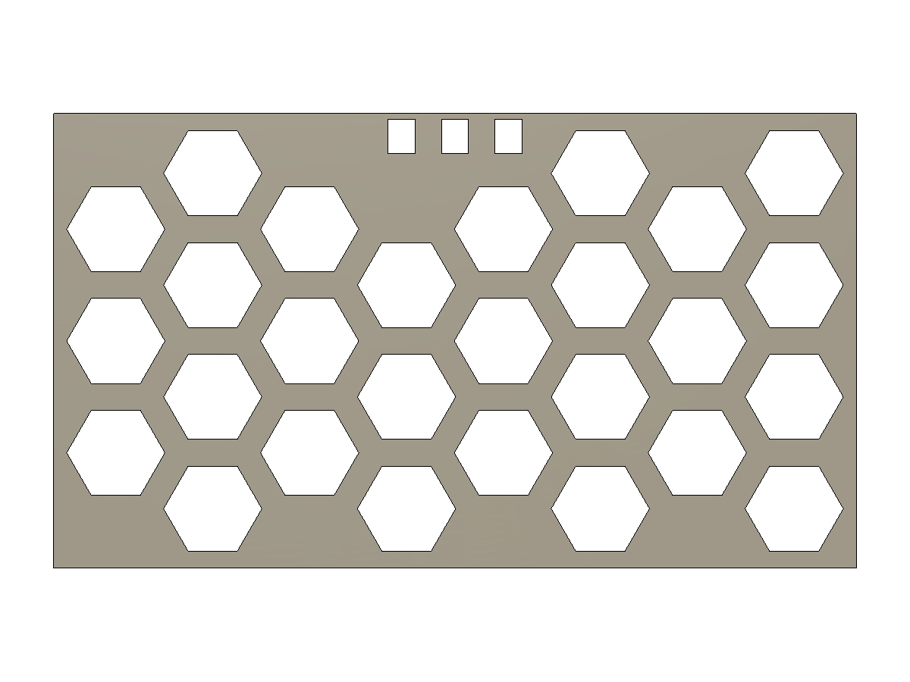
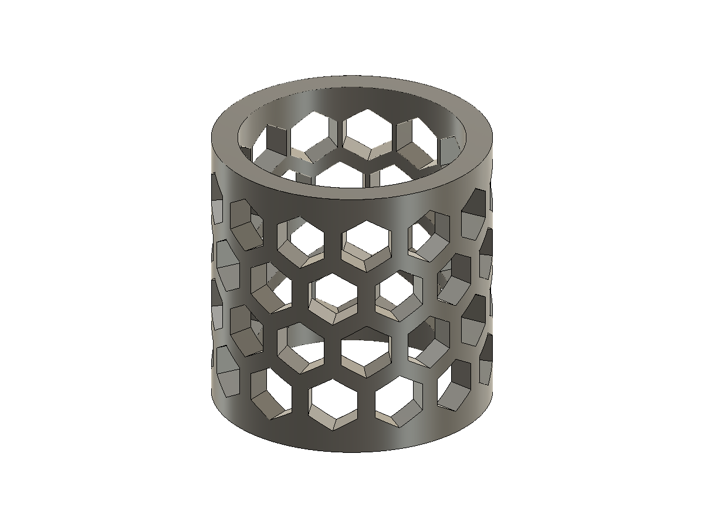
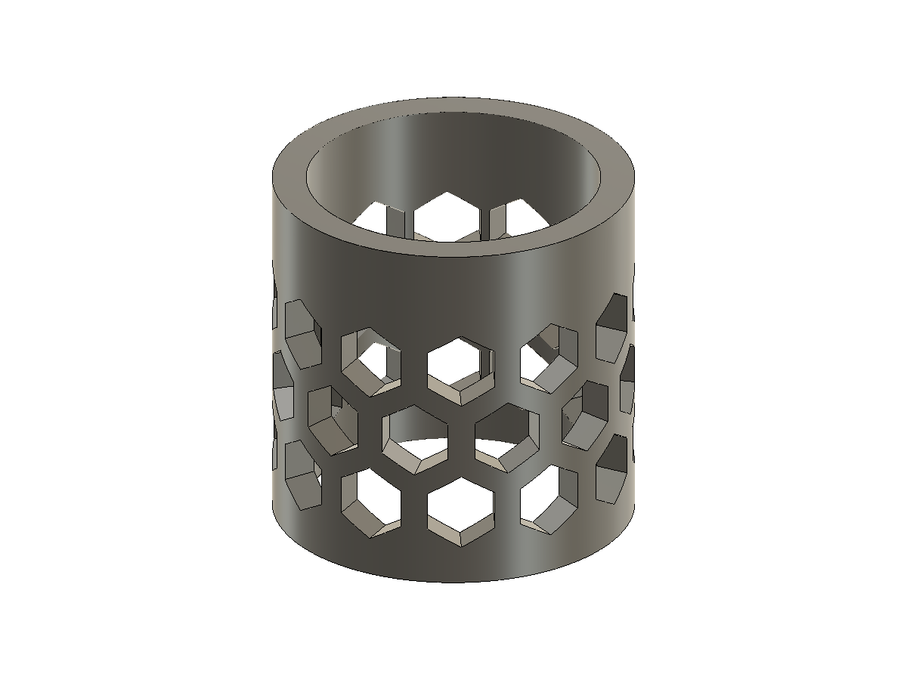
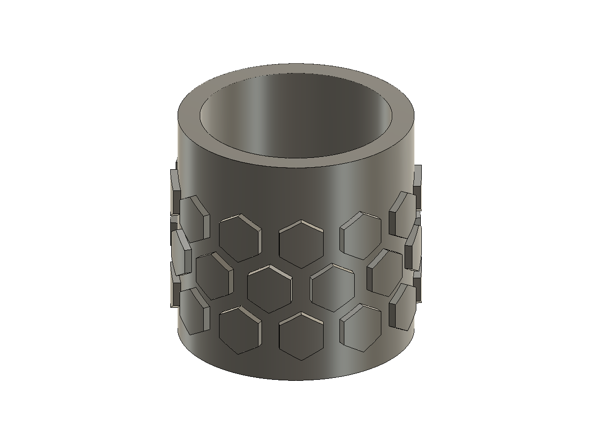
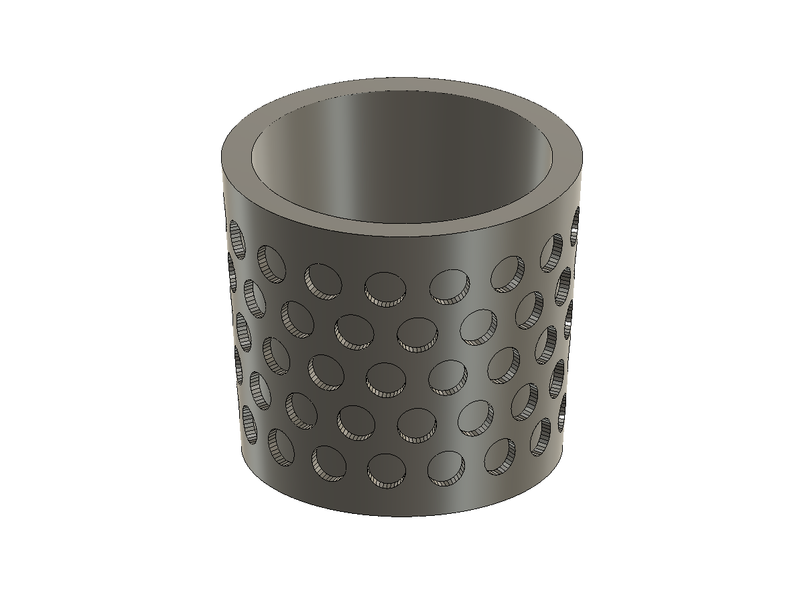
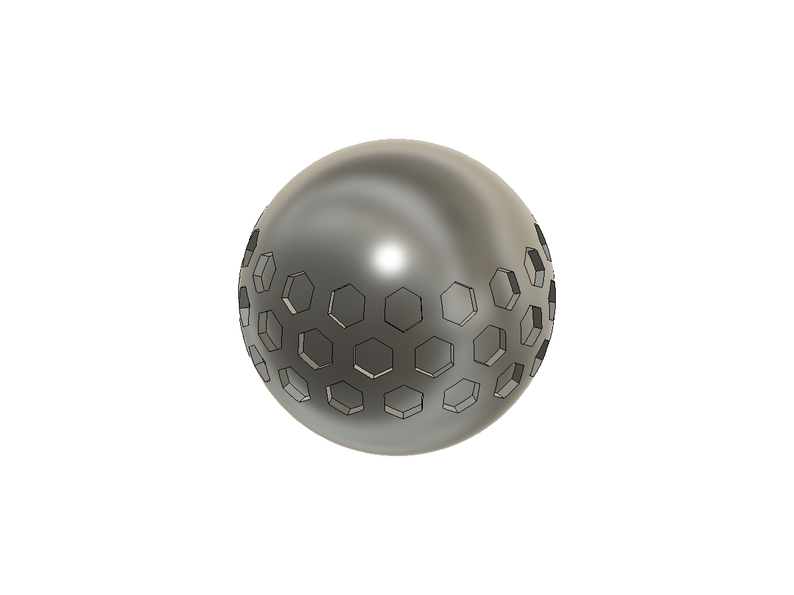

# Surface patterns

Version 0.9.0 adds one pattern workflow behind Honeycomb, Perforations and
Texture in the existing HTML palette. These entries start different presets of
the same tool. Hinge and snap-fit geometry remains locked at the user-approved
behavior.

Version 0.10.0 adds **Automatic** spacing and fixes distance checks against short
trim edges. A short edge beside a top cutout is measured as a finite segment,
not as an infinite supporting line that could exclude a whole column below it.
Curved trim boundaries use cached conservative strokes. Real outside borders
and existing holes remain protected.

## Use

Choose a shape (hexagons, circles, diamonds, squares or slots), then **Through
holes**, **Engrave** or **Emboss**. Select faces on one solid and press Esc when
finished picking. Preselected faces are reused. Start with **Spacing > Automatic**,
target pitch, solid web (gap for emboss), border and depth/height. Through holes do not use a depth setting.
Rotation and offsets live under Advanced.

Automatic spacing centers the grid and chooses one uniform pitch per face near
the target. It never stretches individual hexagons or circles to fill a gap.
The preview reports the actual fitted pitch, or its range across several faces;
the target input remains unchanged. Overly dense layouts receive a larger pitch
to stay within 200 cells per face and 400 in total. With more than two selected
faces, that total budget is shared according to face area.

Choose **Exact pitch** to preserve the earlier layout behavior. Dense exact
layouts still refuse with an approximate larger-pitch hint; that hint does not
change the input. Full periodic cylinders retain their seam-closing adjustment.
Existing saved patterns load in Exact pitch. To update one, choose Edit existing,
switch to Automatic, review the preview and press Rebuild.

The preview shows the complete proposed body with its existing Fusion
appearance. Create changes that same body. Edit accepts its body, face, edge or
owned feature, restores the saved settings, and Rebuild updates the same owned
history. Selection scope is fixed during Edit. Cancel removes the tool's own
preview and restores visibility.

Version 0.10.1 recovers lost preview acknowledgments and completion messages by
reading the current native session status while awaiting a preview. Status
queries run independently of the queued geometry actions. Recovery reuses the
computed result; it does not start another calculation or confirm Create.
Late responses cannot restore an obsolete loading state after completion.

Version 0.10.2 constructs convex cell prisms directly from closed shared BRep
topology, with full healing and analytic volume/winding guards. It avoids the
previous sequence of clipping a box separately against every polygon edge.
Planar face acceptance uses the trim-valid center and enclosing-disk clearance
from every finite boundary; curved faces retain the complete ring checks.
Identical Engrave wall rays are reused only when their normals match exactly.

Through tools remain individually bounded to the first material wall and
intersected with the original source. Eight or more disjoint tools can then be
combined on independent copies and applied in one Difference. Lump counts and
volume agreement establish that every tool contributes separate material;
failure or touching/overlap discards the aggregate and restarts the original
sequential path from pristine inputs. Engrave and Emboss retain sequential
application. Final results still require one solid and fresh source references.

## Surface contract

Actual Fusion CAD examples from the passing native checks:

The owned 300 × 170 mm notched-panel fixture produces 27 complete cells with a
41.81 mm fitted pitch from a 40 mm target. Opposite margins match: 4.90 mm at
the sides and 6.38 mm at the ends. Cuts occupy the left, middle and right below
the cutouts, while their real borders remain solid. This is an example, not a
promise of equal outer margins on arbitrary trimmed or curved faces.

Automatic spacing also closes the cylinder seam with equal cyclic gaps. This
fixture has 52 cells at 7.73 mm from an 8 mm target; its end rims remain solid.

| Through holes on a cylinder | Raised hexagons on a cylinder |
| --- | --- |
|  |  |

| Circle engraving on a cone | Hexagon engraving on a sphere |
| --- | --- |
|  |  |

- Plane charts use physical millimetres. Cylinders use arc length around the
  circumference. A full periodic cylinder distributes an integer number of
  columns without duplicate seam cells, increasing pitch slightly if necessary.
  Native U- or V-periodic faces are normalized to the same circumferential chart.
- Multiple selected faces may cover several sides of a hexagonal or other
  faceted body. Each face retains its border independently; rows are not claimed
  to continue seamlessly across a sharp ridge.
- Other smooth faces use a local surface chart. Singularities, strong distortion
  or excessive curvature are excluded or explicitly refused. This is not a
  guarantee of uniform geodesic spacing on every possible freeform surface.
  Native Automatic checks cover planes and cylinders; the positive cone/sphere
  examples use Exact pitch. Automatic can refuse a curved region when its local
  metric would reduce the requested physical web. Exact pitch is an alternative,
  subject to the same physical-web checks.
- Cells remain complete. Cells too close to a real boundary or a trimmed hole
  are omitted conservatively. A periodic surface seam is not treated as an edge
  border. There are no clipped partial cells or keep-solid masks in this version.
- Through holes stop after the first material wall along the cell direction.
  Parallel boundary/midpoint rays and a single connected intersection reject
  ambiguous re-entry into another wall. They are not unbounded cuts through the
  opposite side of a hollow object.
- Engrave/Emboss use native offset/thickness bands to follow the actual surface
  depth, intersected with each mapped cell. An offset or thickness failure is
  reported; the tool does not substitute a flat-depth cut.
- Whole-body selection includes all faces, including cavity faces. It can be
  refused when those faces lead to overlapping or unsupported operations. For a
  hollow container, select the intended exterior walls explicitly.

The current circle boundary is a 32-segment polygon; slots use a segmented
capsule. Full periodic wraps restrict rotation to lattice-preserving angles:
hexagons 60 degrees, squares/diamonds 90 degrees, slots 180 degrees. Circle
rotation is unrestricted. Nonperiodic faces allow arbitrary rotation.

## Limits and persistence

Pattern preparation enforces 100 selected faces, 200 cells per face and 400 total.
Automatic planning evaluates bounded candidate layouts and checks at most three
finalists against each native surface. Exact pitch retains the 4,000-candidate
limit and specific density refusals.
Sources must be native faces of one solid in the active root of a parametric
design, with the timeline at its end. Assembly proxies are not supported.

Small/rim faces without a complete fitting cell remain unchanged. An empty
overall result is refused. Curved circles are comparatively expensive: the
85-circle cone fixture took 24.78 seconds to prepare; the 36-hexagon full cylinder
took 0.85–2.31 seconds depending on operation. These are measured cases, not a
guarantee of instant live updates on dense geometry.

With the 0.10.2 path, the owned 195-cell notched-panel fixture prepares in
4.00 s versus 8.30 s before the changes; drawing/viewport refresh adds 1.85 s.
These are separate measured stages on that fixture, not a universal speed
guarantee. Through preparation has no timeline features to disable. The final
three owned features provide the existing Edit/Rebuild support.

The full eleven-field settings snapshot is immutable and validated. Version 2
recipes include the spacing mode and selected face/body references. Strict
version 1 recipes with ten fields remain readable as Exact pitch; reading never
rewrites their attributes. Only successful deliberate Rebuild saves version 2.
Source geometry and owned history are
checked before Create/Rebuild; a stale preview cannot be committed. Upstream
changes require an explicit Edit/Rebuild and missing/split face references may
require reselection.

One owned BaseFeature and two Combine features persist the full result while
preserving the selected body's identity, name and visibility. Rebuild replaces
that same tool source. No hidden source backups, dummy bodies or result copies
are added. Failed creation requires native command rollback.

Exact offset bands are copied into temporary geometry and their scratch native
features are removed in `finally`. Live computation runs in a separate
rollback-only native preview command, then draws the detached result after
rollback. Validation uses owned disposable fixtures and checks the user's model
again after the test command is destroyed.

CAD checks do not establish structural strength, waterproofing, slicer support,
material suitability or printability for a particular orientation. In
particular, a perforation shape does not automatically receive a print-oriented
roof/chamfer. Inspect the final orientation in the slicer.
